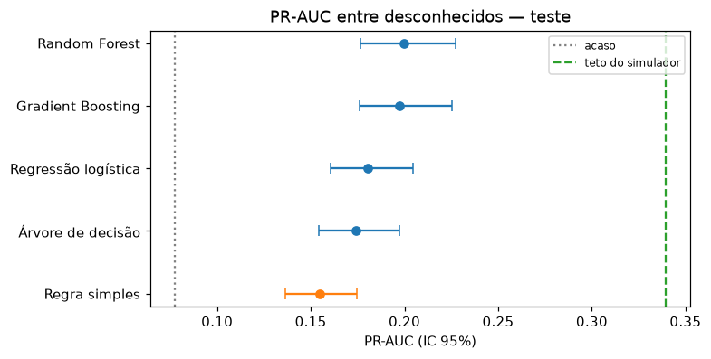
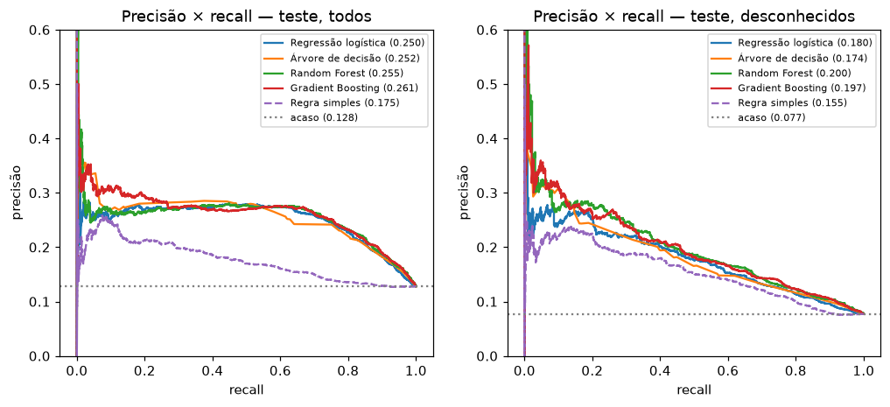
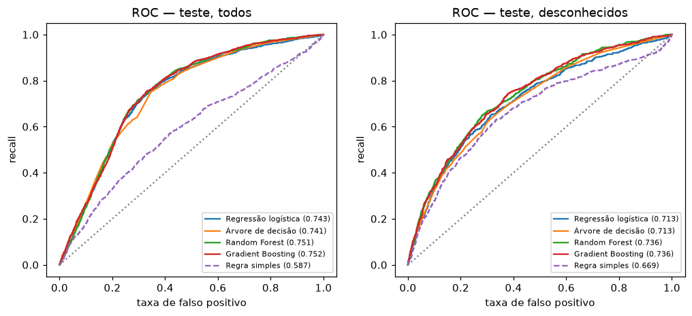
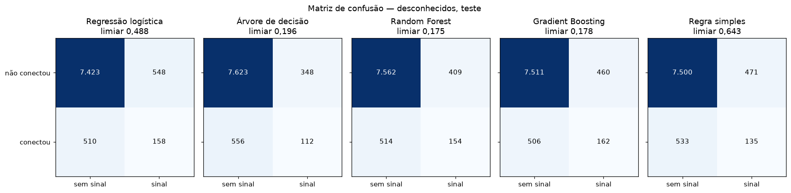
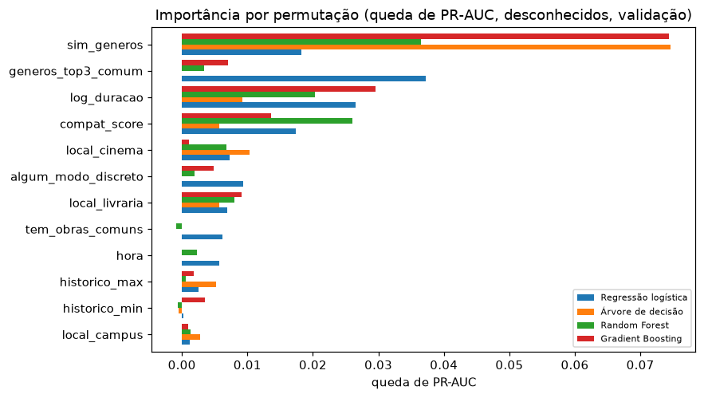

# Comparação de modelos — OpiniOn (CC4)

Gerado por `python -m opinion.modelo.comparar` em 29/10/2026 15:43. Números do teste medidos **uma vez** por modelo; nada foi escolhido com eles.

> Usuários, obras e notas são reais (Amazon Reviews 2023); encontros e o label `conectou` são simulados ([`fontes_dados.md`](fontes_dados.md)). As métricas medem quão bem cada modelo recupera o processo da simulação, não o comportamento de usuários reais da pulseira.

## 1. Protocolo

- **Mesmos dados e split do CC3:** treino semanas 1–8 (44.254 encontros), validação 9–10, teste 11–12; purga na fronteira treino/validação.
- **Cada família** tem uma grade pequena e fixa (`config/modelo.yaml → comparacao`). A configuração e o limiar do sinal (F0,5 entre desconhecidos) são escolhidos na validação. Otimização de hiperparâmetros fica para o CC5 (Optuna) e validação cruzada para o CC6.
- **Escolha do melhor modelo:** pr_auc_desconhecidos na validação. A regra simples (`compat_score`) recebe o mesmo protocolo, com limiar próprio.
- **Incerteza:** intervalo de confiança de 95% por bootstrap pareado (5 pontuações, mesmas reamostras para todas) no teste, entre desconhecidos.

## 2. Resultado

| Modelo | PR-AUC desc. (valid.) | PR-AUC desc. (teste, IC 95%) | PR-AUC geral (teste) | ROC-AUC desc. (teste) | Brier (teste) |
|---|---|---|---|---|---|
| Gradient Boosting **(escolhido)** | 0,194 | 0,197 (0,176–0,225) | 0,261 | 0,736 | 0,101 |
| Random Forest | 0,191 | 0,200 (0,177–0,227) | 0,255 | 0,736 | 0,101 |
| Regressão logística | 0,174 | 0,180 (0,160–0,205) | 0,250 | 0,713 | 0,203 |
| Árvore de decisão | 0,158 | 0,174 (0,154–0,197) | 0,252 | 0,713 | 0,103 |
| Regra simples | 0,149 | 0,155 (0,137–0,175) | 0,175 | 0,669 | não se aplica |
| *acaso* | | *0,077* | *0,128* | *0,500* | *0,112* (constante) |

## 3. No ponto de operação (desconhecidos, teste)

O que a pulseira faria: sinaliza quando a pontuação passa do limiar escolhido na validação.

| Modelo | Limiar | Precisão | Recall | F0,5 | Sinal em | VP | FP | FN | VN |
|---|---|---|---|---|---|---|---|---|---|
| Gradient Boosting | 0,178 | 26,0% | 24,3% | 0,257 | 7,2% | 162 | 460 | 506 | 7.511 |
| Random Forest | 0,175 | 27,4% | 23,1% | 0,264 | 6,5% | 154 | 409 | 514 | 7.562 |
| Regressão logística | 0,488 | 22,4% | 23,7% | 0,226 | 8,2% | 158 | 548 | 510 | 7.423 |
| Árvore de decisão | 0,196 | 24,3% | 16,8% | 0,223 | 5,3% | 112 | 348 | 556 | 7.623 |
| Regra simples | 0,643 | 22,3% | 20,2% | 0,218 | 7,0% | 135 | 471 | 533 | 7.500 |

## 4. Diferenças e incerteza (PR-AUC entre desconhecidos, teste)

| Modelo | vs Regressão logística (IC 95%) | vs regra simples (IC 95%) |
|---|---|---|
| Gradient Boosting | +0,017 (+0,002 a +0,033) | +0,043 (+0,026 a +0,061) |
| Random Forest | +0,019 (+0,005 a +0,036) | +0,045 (+0,030 a +0,062) |
| Regressão logística | — | +0,026 (+0,009 a +0,043) |
| Árvore de decisão | -0,006 (-0,024 a +0,009) | +0,020 (+0,003 a +0,036) |

## 5. Precisão do sinal por contexto (desconhecidos, teste)

| Local | Encontros | Taxa real | Gradient Boosting | Random Forest | Regressão logística | Árvore de decisão | Regra simples |
|---|---|---|---|---|---|---|---|
| campus | 1.675 | 3,2% | 22,2% (1,1%) | 26,3% (1,1%) | 15,0% (1,2%) | 18,2% (0,7%) | 17,9% (4,7%) |
| cinema | 1.564 | 10,4% | 24,0% (12,5%) | 27,3% (11,3%) | 22,7% (13,5%) | 22,7% (12,7%) | 25,0% (8,2%) |
| convencao_games | 2.044 | 11,6% | 29,5% (13,6%) | 30,6% (10,6%) | 23,8% (17,7%) | 30,3% (9,1%) | 32,0% (6,3%) |
| livraria | 3.356 | 6,3% | 22,3% (3,9%) | 23,0% (4,5%) | 18,6% (3,4%) | 13,6% (2,0%) | 17,6% (8,1%) |

Cada célula: precisão (fração de encontros com sinal).

## 6. O que cada modelo usa (importância por permutação, validação)

Queda de PR-AUC entre desconhecidos quando a feature é embaralhada. Top 5 de cada modelo:

| Modelo | 1º | 2º | 3º | 4º | 5º |
|---|---|---|---|---|---|
| Gradient Boosting | `sim_generos` (+0,074) | `log_duracao` (+0,030) | `compat_score` (+0,014) | `local_livraria` (+0,009) | `generos_top3_comum` (+0,007) |
| Random Forest | `sim_generos` (+0,037) | `compat_score` (+0,026) | `log_duracao` (+0,020) | `local_livraria` (+0,008) | `local_cinema` (+0,007) |
| Regressão logística | `generos_top3_comum` (+0,037) | `log_duracao` (+0,026) | `sim_generos` (+0,018) | `compat_score` (+0,017) | `algum_modo_discreto` (+0,009) |
| Árvore de decisão | `sim_generos` (+0,075) | `local_cinema` (+0,010) | `log_duracao` (+0,009) | `local_livraria` (+0,006) | `compat_score` (+0,006) |

## 7. Custo

| Modelo | Configurações testadas | Treino por configuração | Pontuação por encontro |
|---|---|---|---|
| Gradient Boosting | 4 | 0,7 s | 0,005 ms |
| Random Forest | 4 | 2,9 s | 0,015 ms |
| Regressão logística | 6 | 0,2 s | 0,002 ms |
| Árvore de decisão | 6 | 0,2 s | 0,002 ms |

## 8. Análise crítica

- **Escolhido na validação: Gradient Boosting** (0,194). No teste a ordem muda (1º no teste: Random Forest): as diferenças entre eles são pequenas o bastante para mudar de posição com outra amostra.
- **Contra o baseline (Regressão logística):** +0,017 de PR-AUC (IC 95% +0,002 a +0,033). O ganho é estatisticamente consistente no teste.
- **Contra a regra simples:** +0,043 de PR-AUC (IC 95% +0,026 a +0,061) — o modelo supera a regra de forma consistente.
- **No ponto de operação**, Gradient Boosting acerta 26,0% dos sinais (recall 24,3%, sinal em 7,2% dos encontros); a regra, 22,3% (recall 20,2%, sinal em 7,0%). A vantagem aparece também na precisão do sinal, que é o que o usuário sente.
- **Calibração:** prever sempre a prevalência dá Brier 0,112. Regressão logística fica pior que isso (probabilidades infladas, efeito de `class_weight=balanced`); Árvore de decisão, Random Forest e Gradient Boosting ficam melhor. A ordenação e o limiar não dependem disso, mas a probabilidade só pode ser mostrada como chance real (dashboard, faixas de sinal) depois de calibrada.
- **O que os modelos aprendem:** todos têm `log_duracao`, `sim_generos` entre as 3 features mais importantes. Lembrete: a importância reflete as premissas do simulador, não uma descoberta sobre usuários.
- **Margem:** o teto do simulador (a probabilidade escondida) chega a PR-AUC 0,340 e precisão 38,9% com a mesma taxa de sinal; Gradient Boosting está em 0,197 e 26,0%. A parte que falta vem do que nenhum dado observa (a abertura social de cada pessoa) e do sorteio do resultado.
- **Custo:** Gradient Boosting pontua um encontro em 0,005 ms, sem impedimento para o sinal em tempo real (CC7).
- **Recomendação para o CC5:** otimizar Gradient Boosting com Optuna, mantendo o baseline como referência explicável.

## 9. Limitações

- **Label simulado.** O ranking dos modelos vale para o processo da simulação. Com outras premissas (ver os cenários em [`validacao_simulacao.md`](validacao_simulacao.md)) a ordem entre modelos próximos pode mudar.
- **Um único split temporal.** O IC do bootstrap cobre a variação de amostragem do teste, não a de treinar em outras semanas. Estabilidade entre folds é o CC6.
- **Grades fixas e pequenas.** Um modelo pode ter perdido só por falta de ajuste; o CC5 otimiza o vencedor com Optuna.
- **Teto do simulador.** Só existe porque os dados são simulados; serve para dimensionar a margem, não como meta realista.
