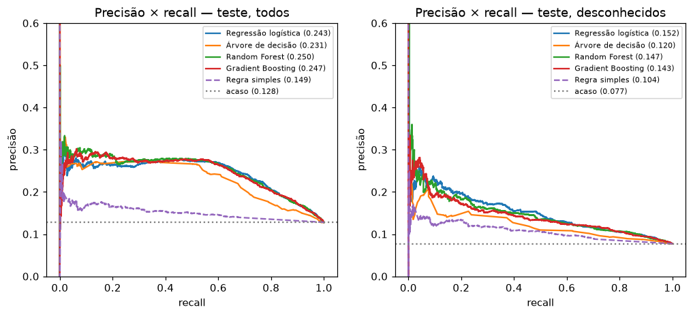
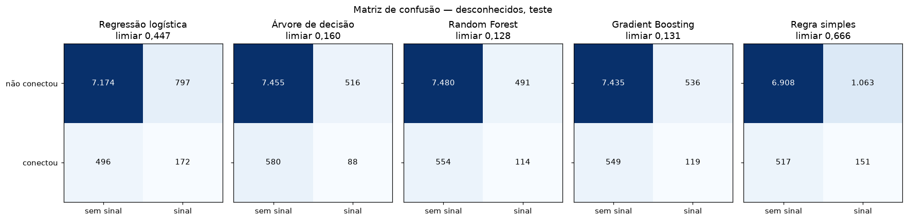

# Comparação de modelos — OpiniOn (CC4)

Gerado por `python -m opinion.modelo.comparar` em 22/11/2026 17:29. Números do teste medidos **uma vez** por modelo; nada foi escolhido com eles.

> Usuários, obras, notas e o rótulo `conectou` (amizade no Last.fm) são reais (HetRec 2011 Last.fm, [`fontes_dados.md`](fontes_dados.md)); só os encontros são simulados, **independentes da amizade**. O rótulo é estático (as amizades não têm data): as métricas mostram quanto o gosto musical acompanha a amizade, não que o encontro a causou, e amigos se influenciam (o gosto pode ser efeito da amizade).

## 1. Protocolo

- **Mesmos dados e split do CC3:** divisão por par (cada par inteiro em treino, validação ou teste), treino com 114.033 encontros.
- **Cada família** tem uma grade pequena e fixa (`config/modelo.yaml → comparacao`). A configuração e o limiar do sinal (F0,5 em todos os encontros) são escolhidos na validação. Otimização de hiperparâmetros fica para o CC5 (Optuna) e validação cruzada para o CC6.
- **Escolha do melhor modelo:** pr_auc na validação. A regra simples (`compat_score`) recebe o mesmo protocolo, com limiar próprio.
- **Incerteza:** intervalo de confiança de 95% por bootstrap pareado (5 pontuações, mesmas reamostras para todas) no teste, em todos os encontros.

## 2. Resultado

| Modelo | PR-AUC (valid.) | PR-AUC (teste, IC 95%) | ROC-AUC (teste) | Brier (teste) |
|---|---|---|---|---|
| Random Forest **(escolhido)** | 0,061 | 0,055 (0,041–0,074) | 0,833 | 0,007 |
| Regressão logística | 0,061 | 0,063 (0,046–0,092) | 0,837 | 0,007 |
| Árvore de decisão | 0,057 | 0,039 (0,028–0,056) | 0,741 | 0,007 |
| Gradient Boosting | 0,050 | 0,053 (0,039–0,078) | 0,827 | 0,007 |
| Regra simples | 0,027 | 0,027 (0,020–0,040) | 0,724 | não se aplica |
| *acaso* | | *0,008* | *0,500* | *0,007* (constante) |

## 3. No ponto de operação (todos os encontros, teste)

O limiar do modelo é uma avaliação acadêmica. O aviso do protótipo usa o corte por categoria na proximidade.

| Modelo | Limiar | Precisão | Recall | F0,5 | Sinal em | VP | FP | FN | VN |
|---|---|---|---|---|---|---|---|---|---|
| Random Forest | 0,076 | 9,5% | 14,1% | 0,102 | 1,1% | 26 | 248 | 158 | 24.065 |
| Regressão logística | 0,134 | 14,8% | 7,1% | 0,121 | 0,4% | 13 | 75 | 171 | 24.238 |
| Árvore de decisão | 0,185 | 9,9% | 5,4% | 0,085 | 0,4% | 10 | 91 | 174 | 24.222 |
| Gradient Boosting | 0,070 | 9,3% | 15,2% | 0,101 | 1,2% | 28 | 273 | 156 | 24.040 |
| Regra simples | 0,866 | 4,8% | 7,6% | 0,051 | 1,2% | 14 | 280 | 170 | 24.033 |

## 4. Diferenças e incerteza (PR-AUC em todos os encontros, teste)

| Modelo | vs Regressão logística (IC 95%) | vs regra simples (IC 95%) |
|---|---|---|
| Random Forest | -0,008 (-0,026 a +0,000) | +0,027 (+0,014 a +0,044) |
| Regressão logística | — | +0,036 (+0,018 a +0,063) |
| Árvore de decisão | -0,025 (-0,049 a -0,008) | +0,011 (-0,003 a +0,028) |
| Gradient Boosting | -0,010 (-0,027 a +0,004) | +0,026 (+0,011 a +0,048) |

## 5. Precisão do sinal por contexto (todos os encontros, teste)

| Local | Encontros | Taxa real | Random Forest | Regressão logística | Árvore de decisão | Gradient Boosting | Regra simples |
|---|---|---|---|---|---|---|---|
| campus | 9.624 | 0,7% | 9,3% (1,0%) | 25,0% (0,4%) | 13,9% (0,4%) | 9,4% (1,2%) | 3,8% (1,1%) |
| cinema | 4.688 | 0,9% | 16,3% (0,9%) | 6,7% (0,3%) | 15,8% (0,4%) | 11,4% (0,9%) | 6,5% (1,3%) |
| convencao_games | 5.012 | 0,8% | 6,8% (1,5%) | 5,0% (0,4%) | 4,2% (0,5%) | 10,5% (1,5%) | 4,3% (1,4%) |
| livraria | 5.173 | 0,8% | 8,2% (1,2%) | 11,8% (0,3%) | 4,5% (0,4%) | 6,2% (1,2%) | 5,2% (1,1%) |

Cada célula: precisão (fração de encontros com sinal).

## 6. O que cada modelo usa (importância por permutação, validação)

Queda de PR-AUC em todos os encontros quando a feature é embaralhada. Top 5 de cada modelo:

| Modelo | 1º | 2º | 3º | 4º | 5º |
|---|---|---|---|---|---|
| Random Forest | `n_obras_comuns` (+0,024) | `favoritas_comuns` (+0,013) | `sim_notas` (+0,004) | `match_musica` (+0,004) | `tem_obras_comuns` (+0,003) |
| Regressão logística | `n_obras_comuns` (+0,035) | `favoritas_comuns` (+0,013) | `tem_obras_comuns` (+0,012) | `compat_score` (+0,002) | `compat_score_musica` (+0,002) |
| Árvore de decisão | `n_obras_comuns` (+0,044) | `favoritas_comuns` (+0,029) | `sim_generos` (+0,025) | `rssi_medio` (+0,012) | `dia_semana` (+0,007) |
| Gradient Boosting | `n_obras_comuns` (+0,035) | `favoritas_comuns` (+0,013) | `sim_notas` (+0,004) | `hora` (+0,002) | `dia_semana` (+0,001) |

## 7. Custo

| Modelo | Configurações testadas | Treino por configuração | Pontuação por encontro |
|---|---|---|---|
| Random Forest | 4 | 3,7 s | 0,005 ms |
| Regressão logística | 6 | 0,3 s | 0,001 ms |
| Árvore de decisão | 6 | 0,3 s | 0,001 ms |
| Gradient Boosting | 4 | 0,6 s | 0,002 ms |

## 8. Análise crítica

- **Escolhido na validação: Random Forest** (0,061). No teste a ordem muda (1º no teste: Regressão logística): as diferenças entre eles são pequenas o bastante para mudar de posição com outra amostra.
- **Contra o baseline (Regressão logística):** -0,008 de PR-AUC (IC 95% -0,026 a +0,000). O intervalo inclui zero: **não dá para afirmar que o modelo mais complexo é melhor que o baseline** com estes dados.
- **Contra a regra simples:** +0,027 de PR-AUC (IC 95% +0,014 a +0,044) — o modelo supera a regra de forma consistente.
- **No ponto de operação**, Random Forest acerta 9,5% dos sinais (recall 14,1%, sinal em 1,1% dos encontros); a regra, 4,8% (recall 7,6%, sinal em 1,2%). A vantagem aparece também na precisão do sinal, que é o que o usuário sente.
- **Calibração:** prever sempre a prevalência dá Brier 0,007. Árvore de decisão fica pior que isso; Regressão logística, Random Forest e Gradient Boosting ficam melhor. A ordenação e o limiar não dependem disso, mas a probabilidade só pode ser mostrada como chance real (dashboard, faixas de sinal) depois de calibrada.
- **O que os modelos aprendem:** todos têm `favoritas_comuns`, `n_obras_comuns` entre as 3 features mais importantes. Lembrete: o rótulo é amizade real no Last.fm, mas estática (sem data), e os encontros são simulados; a importância mostra associação com a amizade, não causa.
- **Custo:** Random Forest pontua um encontro em 0,005 ms, sem impedimento para o sinal em tempo real (CC7).
- **Recomendação para o CC5:** otimizar Random Forest com Optuna, mantendo o baseline como referência explicável.

## 9. Limitações

- **Rótulo estático e possível causalidade invertida.** A amizade não tem data: não dá para afirmar que o gosto antecede a amizade nem que o encontro a causou (amigos se influenciam).
- **Encontros simulados, independentes da amizade.** Local, duração e RSSI não carregam sinal real do rótulo; o poder preditivo vem do gosto musical (Last.fm).
- **Um único split por par.** O IC do bootstrap cobre a variação de amostragem do teste, não a de outras divisões; estabilidade entre folds é o CC6.
- **Grades fixas e pequenas.** Um modelo pode ter perdido só por falta de ajuste; o CC5 otimiza o vencedor com Optuna.
