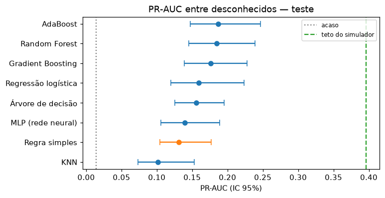
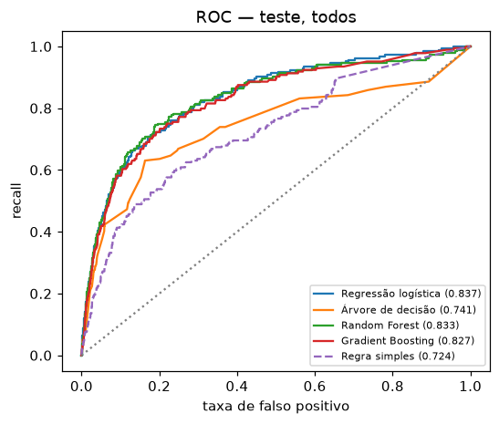
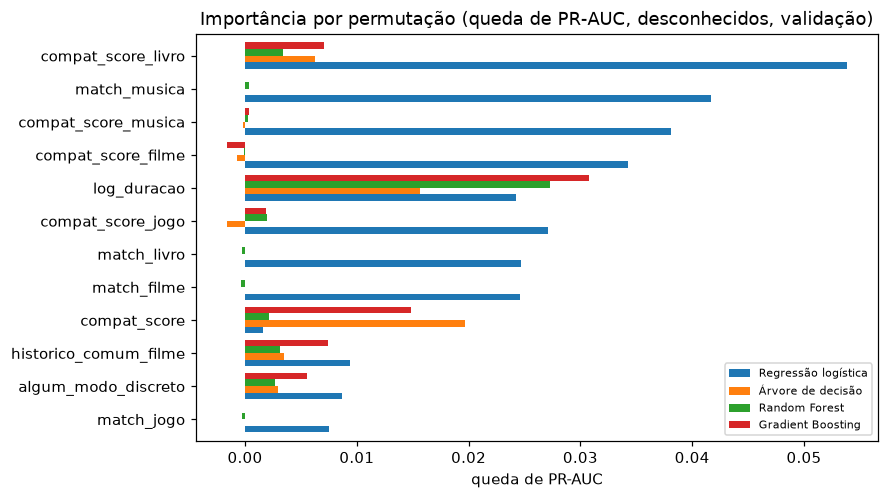

# Comparação de modelos — OpiniOn (CC4)

**Experimento histórico.** Este relatório foi gerado antes da regeneração do bootstrap com a
regra de aviso por categoria. Seus números e figuras não descrevem os dados atuais.
Consulte [os resultados por mídia](match_por_midia.md) para a versão em uso.

Gerado por `python -m opinion.modelo.comparar` em 18/11/2026 23:19. Números do teste medidos **uma vez** por modelo; nada foi escolhido com eles.

> Usuários, obras e notas são reais (Amazon Reviews 2023); encontros e o label `conectou` são simulados ([`fontes_dados.md`](fontes_dados.md)). As métricas medem quão bem cada modelo recupera o processo da simulação, não o comportamento de usuários reais da pulseira.

## 1. Protocolo

- **Mesmos dados e split do CC3:** treino semanas 1–8 (44.254 encontros), validação 9–10, teste 11–12; purga na fronteira treino/validação.
- **Cada família** tem uma grade pequena e fixa (`config/modelo.yaml → comparacao`). A configuração e o limiar do sinal (F0,5 entre desconhecidos) são escolhidos na validação. Otimização de hiperparâmetros fica para o CC5 (Optuna) e validação cruzada para o CC6.
- **Escolha do melhor modelo:** pr_auc_desconhecidos na validação. A regra simples (`compat_score`) recebe o mesmo protocolo, com limiar próprio.
- **Incerteza:** intervalo de confiança de 95% por bootstrap pareado (5 pontuações, mesmas reamostras para todas) no teste, entre desconhecidos.

## 2. Resultado

| Modelo | PR-AUC desc. (valid.) | PR-AUC desc. (teste, IC 95%) | PR-AUC geral (teste) | ROC-AUC desc. (teste) | Brier (teste) |
|---|---|---|---|---|---|
| Gradient Boosting **(escolhido)** | 0,135 | 0,143 (0,126–0,162) | 0,247 | 0,672 | 0,103 |
| Random Forest | 0,134 | 0,147 (0,130–0,167) | 0,250 | 0,675 | 0,103 |
| Regressão logística | 0,134 | 0,152 (0,135–0,173) | 0,243 | 0,681 | 0,205 |
| Árvore de decisão | 0,105 | 0,120 (0,107–0,135) | 0,231 | 0,624 | 0,107 |
| Regra simples | 0,092 | 0,104 (0,093–0,118) | 0,149 | 0,586 | não se aplica |
| *acaso* | | *0,077* | *0,128* | *0,500* | *0,112* (constante) |

## 3. No ponto de operação (desconhecidos, teste)

Esta seção avalia uma política de sinal da rodada histórica. O protótipo atual avisa por
categoria na proximidade, conforme o corte fixado em `config/pipeline.yaml`.

| Modelo | Limiar | Precisão | Recall | F0,5 | Sinal em | VP | FP | FN | VN |
|---|---|---|---|---|---|---|---|---|---|
| Gradient Boosting | 0,131 | 18,2% | 17,8% | 0,181 | 7,6% | 119 | 536 | 549 | 7.435 |
| Random Forest | 0,128 | 18,8% | 17,1% | 0,185 | 7,0% | 114 | 491 | 554 | 7.480 |
| Regressão logística | 0,447 | 17,8% | 25,7% | 0,189 | 11,2% | 172 | 797 | 496 | 7.174 |
| Árvore de decisão | 0,160 | 14,6% | 13,2% | 0,143 | 7,0% | 88 | 516 | 580 | 7.455 |
| Regra simples | 0,666 | 12,4% | 22,6% | 0,137 | 14,1% | 151 | 1.063 | 517 | 6.908 |

## 4. Diferenças e incerteza (PR-AUC entre desconhecidos, teste)

| Modelo | vs Regressão logística (IC 95%) | vs regra simples (IC 95%) |
|---|---|---|
| Gradient Boosting | -0,010 (-0,019 a +0,001) | +0,038 (+0,025 a +0,054) |
| Random Forest | -0,005 (-0,016 a +0,006) | +0,043 (+0,030 a +0,059) |
| Regressão logística | — | +0,048 (+0,034 a +0,063) |
| Árvore de decisão | -0,033 (-0,048 a -0,018) | +0,015 (+0,003 a +0,029) |

## 5. Precisão do sinal por contexto (desconhecidos, teste)

| Local | Encontros | Taxa real | Gradient Boosting | Random Forest | Regressão logística | Árvore de decisão | Regra simples |
|---|---|---|---|---|---|---|---|
| campus | 1.675 | 3,2% | 0,0% (0,3%) | 25,0% (0,2%) | 7,7% (1,6%) | 4,0% (3,0%) | 6,4% (12,1%) |
| cinema | 1.564 | 10,4% | 17,9% (10,4%) | 17,5% (10,9%) | 16,4% (18,3%) | 14,5% (11,0%) | 14,2% (14,8%) |
| convencao_games | 2.044 | 11,6% | 20,2% (17,7%) | 19,3% (17,3%) | 18,7% (25,9%) | 21,0% (8,6%) | 18,5% (12,7%) |
| livraria | 3.356 | 6,3% | 13,5% (3,8%) | 19,5% (2,3%) | 18,8% (3,8%) | 11,7% (6,1%) | 11,0% (15,5%) |

Cada célula: precisão (fração de encontros com sinal).

## 6. O que cada modelo usa (importância por permutação, validação)

Queda de PR-AUC entre desconhecidos quando a feature é embaralhada. Top 5 de cada modelo:

| Modelo | 1º | 2º | 3º | 4º | 5º |
|---|---|---|---|---|---|
| Gradient Boosting | `log_duracao` (+0,031) | `compat_score` (+0,015) | `historico_comum_filme` (+0,007) | `compat_score_livro` (+0,007) | `algum_modo_discreto` (+0,006) |
| Random Forest | `log_duracao` (+0,027) | `local_cinema` (+0,006) | `compat_score_livro` (+0,003) | `local_livraria` (+0,003) | `historico_comum_filme` (+0,003) |
| Regressão logística | `compat_score_livro` (+0,054) | `match_musica` (+0,042) | `compat_score_musica` (+0,038) | `compat_score_filme` (+0,034) | `compat_score_jogo` (+0,027) |
| Árvore de decisão | `compat_score` (+0,020) | `log_duracao` (+0,016) | `compat_score_livro` (+0,006) | `local_cinema` (+0,005) | `sim_generos` (+0,005) |

## 7. Custo

| Modelo | Configurações testadas | Treino por configuração | Pontuação por encontro |
|---|---|---|---|
| Gradient Boosting | 4 | 0,5 s | 0,002 ms |
| Random Forest | 4 | 1,0 s | 0,005 ms |
| Regressão logística | 6 | 0,1 s | 0,001 ms |
| Árvore de decisão | 6 | 0,1 s | 0,001 ms |

## 8. Análise crítica

- **Escolhido na validação: Gradient Boosting** (0,135). No teste a ordem muda (1º no teste: Regressão logística): as diferenças entre eles são pequenas o bastante para mudar de posição com outra amostra.
- **Contra o baseline (Regressão logística):** -0,010 de PR-AUC (IC 95% -0,019 a +0,001). O intervalo inclui zero: **não dá para afirmar que o modelo mais complexo é melhor que o baseline** com estes dados.
- **Contra a regra simples:** +0,038 de PR-AUC (IC 95% +0,025 a +0,054) — o modelo supera a regra de forma consistente.
- **No ponto de operação**, Gradient Boosting acerta 18,2% dos sinais (recall 17,8%, sinal em 7,6% dos encontros); a regra, 12,4% (recall 22,6%, sinal em 14,1%). A vantagem aparece também na precisão do sinal, que é o que o usuário sente.
- **Calibração:** prever sempre a prevalência dá Brier 0,112. Regressão logística fica pior que isso (probabilidades infladas, efeito de `class_weight=balanced`); Árvore de decisão, Random Forest e Gradient Boosting ficam melhor. A ordenação e o limiar não dependem disso, mas a probabilidade só pode ser mostrada como chance real (dashboard, faixas de sinal) depois de calibrada.
- **O que os modelos aprendem:** as 3 features mais importantes variam entre os modelos. Lembrete: a importância reflete as premissas do simulador, não uma descoberta sobre usuários.
- **Margem:** o teto do simulador (a probabilidade escondida) chega a PR-AUC 0,340 e precisão 38,3% com a mesma taxa de sinal; Gradient Boosting está em 0,143 e 18,2%. A parte que falta vem do que nenhum dado observa (a abertura social de cada pessoa) e do sorteio do resultado.
- **Custo:** Gradient Boosting pontua um encontro em 0,002 ms, sem impedimento para o sinal em tempo real (CC7).
- **Recomendação para o CC5:** otimizar Gradient Boosting com Optuna, mantendo o baseline como referência explicável.

## 9. Limitações

- **Label simulado.** O ranking dos modelos vale para o processo da simulação. Com outras premissas (ver os cenários em [`validacao_simulacao.md`](validacao_simulacao.md)) a ordem entre modelos próximos pode mudar.
- **Um único split temporal.** O IC do bootstrap cobre a variação de amostragem do teste, não a de treinar em outras semanas. Estabilidade entre folds é o CC6.
- **Grades fixas e pequenas.** Um modelo pode ter perdido só por falta de ajuste; o CC5 otimiza o vencedor com Optuna.
- **Teto do simulador.** Só existe porque os dados são simulados; serve para dimensionar a margem, não como meta realista.
