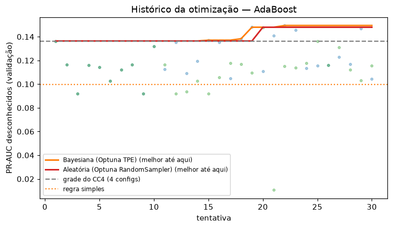
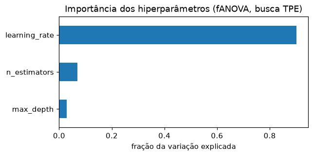
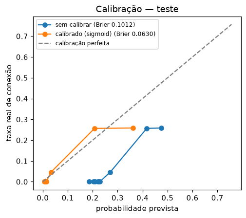

# Otimização de hiperparâmetros — OpiniOn (CC5)

Gerado por `python -m opinion.modelo.otimizar` em 27/11/2026 19:54. Todos os experimentos estão no MLflow, no experimento `opinion-cc5-otimizacao`: um run pai, um run filho por tentativa e o modelo final registrado como `opinion-cc5-otimizado@otimizado`.

> Os encontros e o label são simulados (ver [`fontes_dados.md`](fontes_dados.md)). Os números medem o quanto o modelo recupera o processo da simulação.

## 1. Estratégia adotada

- **Modelo otimizado:** AdaBoost, escolhido na validação do CC4 ([`comparacao_modelos.md`](comparacao_modelos.md)).
- **Técnica principal:** otimização bayesiana com **Optuna** (amostrador TPE). Para saber se a estratégia compensa, rodamos uma **busca aleatória** com o mesmo orçamento (30 tentativas) e comparamos as duas com a **grade fixa** do CC4 (4 configurações). As duas buscas começam pela melhor configuração da grade, então nenhuma termina pior que ela na validação.
- **Função objetivo:** PR-AUC entre desconhecidos na validação temporal (semanas 9–10), a mesma métrica de escolha do CC3 e do CC4. Cada tentativa treina nas semanas 1–8.
- **O teste (semanas 11–12) não participa da busca.** Ele é medido uma vez, com a configuração final.
- **Calibração:** depois da busca, as probabilidades são calibradas na validação (`sigmoid`). A transformação é monótona: a ordenação e a PR-AUC não mudam, mas a probabilidade passa a poder ser exibida como chance na API e no dashboard.
- **Limiar do sinal:** máximo de F0,5 entre desconhecidos na validação, como antes.

## 2. Parâmetros avaliados

| Hiperparâmetro | Espaço de busca |
|---|---|
| `n_estimators` | inteiro de 50 a 300 |
| `learning_rate` | real de 0.01 a 1.0 (escala log) |
| `max_depth` | inteiro de 1 a 4 |

Espaços em `config/modelo.yaml → otimizacao.espacos`.

## 3. Resultados da busca (validação)

| Estratégia | Tentativas | Melhor PR-AUC desc. | Tentativa do melhor | Tempo | Melhor configuração |
|---|---|---|---|---|---|
| Bayesiana (Optuna TPE) | 30 | 0,1495 | 22 | 455 s | `n_estimators=292, learning_rate=0.93842, max_depth=1` |
| Aleatória (Optuna RandomSampler) | 30 | 0,1480 | 20 | 467 s | `n_estimators=200, learning_rate=0.69783, max_depth=1` |
| Grade fixa do CC4 | 4 | 0,1364 | — | 55 s | `n_estimators=200, learning_rate=0.5, max_depth=1` |
| Regra simples | — | 0,0997 | — | — | — |

**Configuração final** (melhor de todas as tentativas, encontrada pela busca bayesiana): `n_estimators=292, learning_rate=0.93842, max_depth=1`.

**Importância dos hiperparâmetros** (fANOVA sobre as tentativas TPE): `learning_rate` 90,1%, `n_estimators` 7,0%, `max_depth` 2,9%.

## 4. Teste (medido uma vez)

| Modelo | PR-AUC desc. (IC 95%) | PR-AUC geral | ROC-AUC desc. | Brier | Precisão no limiar | Recall | Sinal em |
|---|---|---|---|---|---|---|---|
| AdaBoost otimizado e calibrado | 0,188 (0,146–0,248) | 0,269 | 0,954 | 0,0630 | 22,1% | 27,6% | 1,7% |
| AdaBoost da grade do CC4 | 0,186 (0,148–0,246) | 0,269 | 0,955 | 0,0883 | 24,1% | 11,4% | 0,7% |
| Regra simples | 0,131 (0,104–0,177) | 0,103 | 0,937 | não se aplica | 18,8% | 9,8% | 0,7% |
| *acaso* | *0,014* | *0,080* | *0,500* | | | | |

Diferença de PR-AUC entre desconhecidos no teste (bootstrap pareado): contra a grade do CC4 +0,001 (IC 95% -0,015 a +0,020); contra a regra +0,057 (IC 95% +0,017 a +0,100).

## 5. Análise

- **Bayesiana x aleatória:** com o mesmo orçamento, o TPE chegou a 0,1495 e a busca aleatória a 0,1480 (+0,001). A diferença é pequena: neste espaço, a busca aleatória já cobre bem as regiões boas.
- **Contra a grade do CC4 (validação):** +0,013 de PR-AUC (as duas buscas partem da melhor configuração da grade). A otimização encontrou uma região melhor do que a grade cobria.
- **No teste,** o ganho sobre a grade é +0,001 (IC 95% -0,015 a +0,020). O intervalo inclui zero: o ganho da validação não se confirma de forma consistente no teste, o que é esperado quando muitas tentativas competem pelo mesmo conjunto de validação.
- **Contra a regra simples (teste):** +0,057 (IC 95% +0,017 a +0,100), vantagem consistente.
- **Calibração:** o Brier do teste foi de 0,1012 sem calibrar para 0,0630 depois da sigmoide. É essa versão calibrada que a API serve como "chance de interação em 48 h".
- **O que mais pesa:** `learning_rate` explica 90,1% da variação da métrica entre as tentativas. Os demais hiperparâmetros têm efeito menor, o que indica uma superfície de busca relativamente plana.

## 6. Limitações

- **Seleção na validação.** Com dezenas de tentativas avaliadas no mesmo conjunto, o melhor valor de validação é otimista; a diferença para o teste mede esse viés. A estabilidade entre partições é avaliada no CC6 ([`validacao_cruzada.md`](validacao_cruzada.md)).
- **Calibração na validação.** O mesmo conjunto escolhe hiperparâmetros, ajusta a sigmoide e o limiar. Como a sigmoide tem dois parâmetros, o risco de sobreajuste é pequeno, e o Brier do teste confirma.
- **Label simulado.** Os hiperparâmetros ótimos dependem das premissas da simulação e devem ser revistos com os dados dos testes do Design (semana 16).
