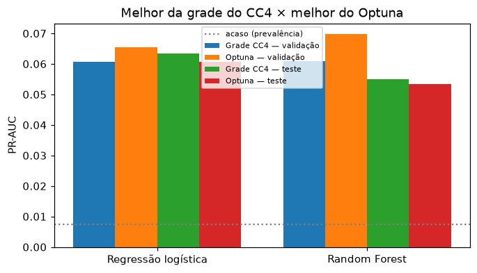
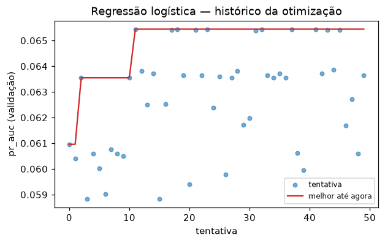
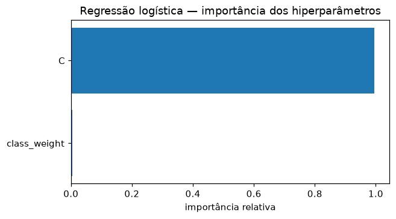
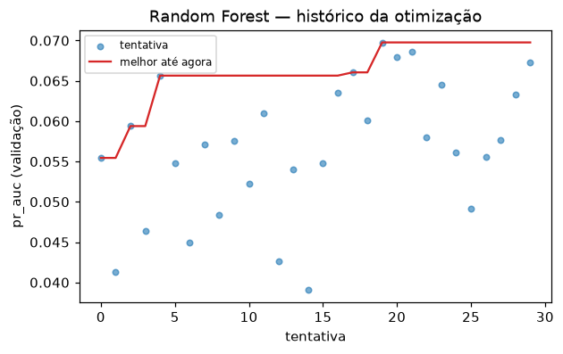
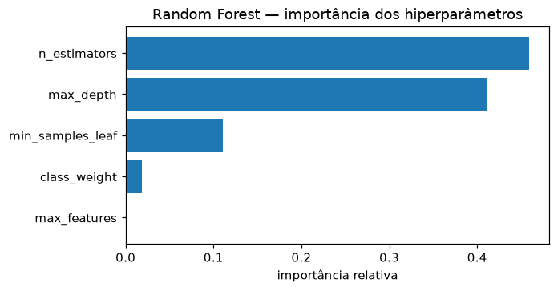

# Otimização de hiperparâmetros — OpiniOn (CC5)

Gerado por `python -m opinion.modelo.otimizar` em 22/11/2026 18:08. Números do teste medidos **uma vez** por família (e a melhor da grade do CC4, só para comparação); nada foi escolhido com eles.

> Usuários, obras, notas e o rótulo `conectou` (amizade no Last.fm) são reais (HetRec 2011 Last.fm, [`fontes_dados.md`](fontes_dados.md)); só os encontros são simulados, **independentes da amizade**. O rótulo é estático (as amizades não têm data): as métricas mostram quanto o gosto musical acompanha a amizade, não que o encontro a causou.

## 1. Estratégia

- **Busca bayesiana (TPE, Optuna)** com semente fixa; o objetivo de cada tentativa é a pr_auc na validação (todos os encontros), com o modelo ajustado só no treino (114.033 encontros; validação 24.367, teste 24.497).
- **Padronização dentro do pipeline** (logística), ajustada só no treino de cada tentativa.
- **Limiar do sinal** (F0,5) escolhido na validação, como no CC3/CC4.
- **O melhor de cada família é reajustado e o teste é medido uma única vez.** A família vencedora também é escolhida na validação.
- Espaços e número de tentativas ficam em `config/modelo.yaml → otimizacao`.

## 2. Espaços de busca

**Regressão logística** — 50 tentativas

| Hiperparâmetro | Espaço |
|---|---|
| `C` | 1e-05 a 100 (escala log) |
| `class_weight` | {nulo, balanced} |

**Random Forest** — 30 tentativas

| Hiperparâmetro | Espaço |
|---|---|
| `n_estimators` | 100 a 400 |
| `max_depth` | 2 a 24 |
| `min_samples_leaf` | 5 a 200 (escala log) |
| `max_features` | {sqrt, log2, 0.5} |
| `class_weight` | {nulo, balanced, balanced_subsample} |

## 3. Melhor da grade do CC4 × melhor do Optuna

PR-AUC em todos os encontros. Prevalência no teste: 0,008; regra simples (`compat_score`): validação 0,027, teste 0,027.

| Família | Grade CC4 (valid.) | Optuna (valid.) | Grade CC4 (teste) | Optuna (teste) | Δ teste |
|---|---|---|---|---|---|
| Regressão logística | 0,061 | 0,065 | 0,063 | 0,061 | -0,002 |
| Random Forest **(escolhido)** | 0,061 | 0,070 | 0,055 | 0,053 | -0,002 |
| Regra simples | 0,027 | | 0,027 | | |
| *acaso (prevalência)* | | | *0,008* | | |

## 4. Parâmetros vencedores

| Família | Parâmetros | Limiar | Valid. PR-AUC | Teste PR-AUC | ROC-AUC (teste) | Brier (teste) |
|---|---|---|---|---|---|---|
| Regressão logística | `C=2.064e-05`, `class_weight=None` | 0,010 | 0,065 | 0,061 | 0,817 | 0,007 |
| Random Forest | `n_estimators=109`, `max_depth=3`, `min_samples_leaf=6`, `max_features=0.5`, `class_weight=None` | 0,074 | 0,070 | 0,053 | 0,823 | 0,007 |

### No ponto de operação (teste, todos os encontros)

| Modelo | Limiar | Precisão | Recall | F0,5 | Sinal em | VP | FP | FN | VN |
|---|---|---|---|---|---|---|---|---|---|
| Regressão logística | 0,010 | 11,0% | 17,4% | 0,119 | 1,2% | 32 | 258 | 152 | 24.055 |
| Random Forest | 0,074 | 8,8% | 15,8% | 0,096 | 1,3% | 29 | 301 | 155 | 24.012 |
| Regra simples | 0,866 | 4,8% | 7,6% | 0,051 | 1,2% | 14 | 280 | 170 | 24.033 |

## 5. Custo

| Família | Tentativas | Tempo total | Por tentativa | Mais lenta |
|---|---|---|---|---|
| Regressão logística | 50 | 15,1 s | 0,3 s | 0,7 s |
| Random Forest | 30 | 102,3 s | 3,4 s | 11,5 s |

## 6. Análise

- **Escolhido na validação: Random Forest** (PR-AUC 0,070; teste 0,053).
- **Regressão logística:** Optuna +0,004 na validação e -0,002 no teste em relação à melhor da grade do CC4 — o ajuste fino não ajudou no teste (a diferença pode estar dentro do ruído de uma única divisão; só o CC6 estima esse ruído).
- **Random Forest:** Optuna +0,009 na validação e -0,002 no teste em relação à melhor da grade do CC4 — o ajuste fino não ajudou no teste (a diferença pode estar dentro do ruído de uma única divisão; só o CC6 estima esse ruído).
- **O vencedor na validação (Random Forest 0,070 × Regressão logística 0,065) fica abaixo de Regressão logística no teste (0,053 × 0,061).** A diferença na validação é de 0,005; a escolha seguiu a regra da validação, e o CC6 (validação cruzada) decide com mais dados.
- **Regressão logística: o melhor ponto está na borda do espaço de busca** (`C=2.064e-05` (mínimo do espaço)); não é um ótimo interior. Em `C` a busca empurra para a regularização máxima, isto é, para modelos mais simples. O ganho do Optuna sobre a grade do CC4 na validação (+0,004) não se transferiu ao teste (-0,002); por isso o espaço foi mantido, sem ampliá-lo mais.
- **Random Forest: o melhor ponto está na borda do espaço de busca** (`n_estimators=109` (mínimo do espaço), `max_depth=3` (mínimo do espaço), `min_samples_leaf=6` (mínimo do espaço)); não é um ótimo interior. Em `max_depth` a busca empurra para a regularização máxima, isto é, para modelos mais simples. `n_estimators` e `min_samples_leaf` na borda: nota neutra, sem leitura de regularização nessa direção. O ganho do Optuna sobre a grade do CC4 na validação (+0,009) não se transferiu ao teste (-0,002); por isso o espaço foi mantido, sem ampliá-lo mais.
- **Contra a prevalência e a regra simples:** o vencedor tem PR-AUC 0,053 no teste, 7,1x a prevalência (0,008); a regra `compat_score` tem 0,027 (+0,026 de diferença).
- **No ponto de operação**, Random Forest acerta 8,8% dos sinais (recall 15,8%, sinal em 1,3% dos encontros).
- **Hiperparâmetro mais influente em Regressão logística:** `C` (99,5% da importância); a busca mostra o que importa neste conjunto, não uma regra geral.
- **Hiperparâmetro mais influente em Random Forest:** `n_estimators` (45,9% da importância); a busca mostra o que importa neste conjunto, não uma regra geral.

## 7. Limitações

- **Um único split por par.** A diferença entre grade e Optuna no teste pode estar dentro do ruído de amostragem; a estabilidade entre folds é o CC6.
- **O valor da validação das tentativas é otimista**: o melhor de N tentativas foi escolhido por esse mesmo número. O teste (medido uma vez) é a referência honesta.
- **Rótulo estático e encontros simulados** (ver aviso no topo): as métricas medem o quanto o gosto musical acompanha a amizade; ranking de modelos e de hiperparâmetros não é uma descoberta sobre usuários.
