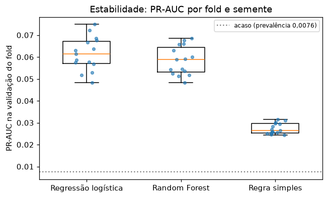
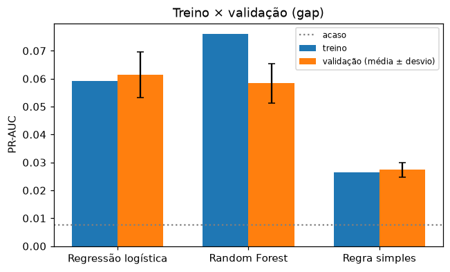
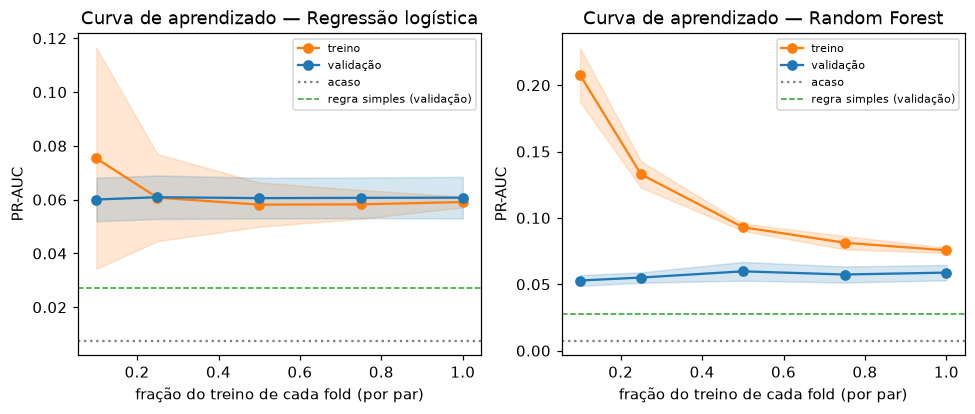
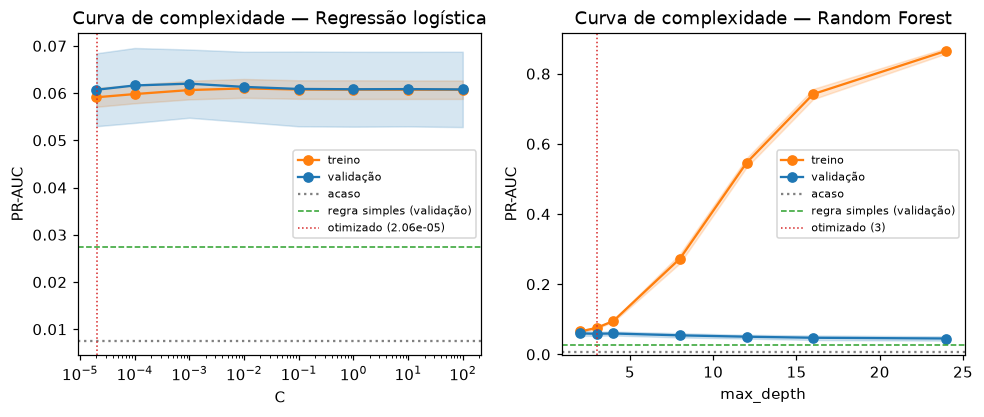
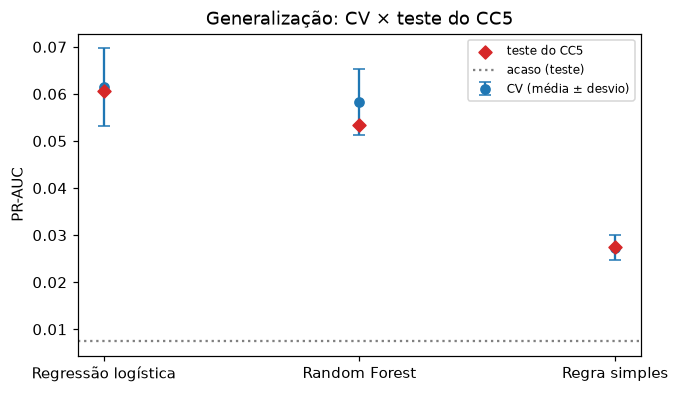

# Validação cruzada, estabilidade e generalização — OpiniOn (CC6)

Gerado por `python -m opinion.modelo.validar` em 23/11/2026 11:45. A validação cruzada usa **só treino + validação**; o teste não entra. Os números do teste vêm do CC5, apenas para comparar.

> Usuários, obras, notas e o rótulo `conectou` (amizade no Last.fm) são reais (HetRec 2011 Last.fm, [`fontes_dados.md`](fontes_dados.md)); só os encontros são simulados, **independentes da amizade**. O rótulo é estático (as amizades não têm data): as métricas mostram quanto o gosto musical acompanha a amizade, não que o encontro a causou.

## 1. Estratégia de validação

- **Dados:** 138.400 encontros de 130.230 pares (os grupos de treino e validação do split por par), 1.051 positivos (prevalência 0,0076). Público avaliado: todos os encontros.
- **5 folds, estratificados e agrupados por `par_id`** (`StratifiedGroupKFold`), repetidos com 3 sementes (0, 1, 2) → 15 validações por modelo.
- **Por que estratificada:** os positivos são raros (menos de 1%). Um k-fold simples poderia deixar um fold com poucos ou nenhum positivo, e a PR-AUC dele seria ruído ou nem existiria. A estratificação mantém a prevalência parecida em todos os folds; o código falha alto se algum fold (treino ou validação) ficar sem positivo.
- **Por que agrupada por par:** cada par tem vários encontros com o mesmo rótulo (e features muito parecidas). Um k-fold comum por linha colocaria encontros do mesmo par no treino e na validação: o modelo "reconheceria" o par e a métrica ficaria inflada. Agrupar por `par_id` garante que um par inteiro está ou no treino ou na validação (é o mesmo critério do split treino/validação/teste do projeto, feito por par).
- **Por que não Leave-One-Out:** com 138.400 encontros seriam 138.400 ajustes por modelo, um custo inviável sem ganho de informação; pior, LOO por linha deixaria os outros encontros do mesmo par no treino (vazamento entre pares). O análogo correto seria deixar um par de fora por vez: caro e de alta variância; k = 5 agrupado é o compromisso usual.
- **Padronização dentro do pipeline** da logística, ajustada só no treino de cada fold.
- **Hiperparâmetros do CC5** (escolhidos na validação do CC5): Regressão logística: `C=2.064e-05`, `class_weight=None`; Random Forest: `n_estimators=109`, `max_depth=3`, `min_samples_leaf=6`, `max_features=0.5`, `class_weight=None`. A regra simples (`compat_score`) é usada como pontuação, sem ajuste.

## 2. Resultado da validação cruzada

PR-AUC na validação de cada fold (15 valores por modelo). Desvio = desvio entre os folds (média dos desvios de cada semente); CV% = desvio / média. Gap = PR-AUC de treino − validação.

| Modelo | PR-AUC (média ± desvio) | CV% | Mín–máx | ROC-AUC (média ± desvio) | PR-AUC no treino | Gap PR-AUC | Gap ROC-AUC |
|---|---|---|---|---|---|---|---|
| Regressão logística | 0,061 ± 0,008 | 13,5% | 0,048–0,075 | 0,803 ± 0,014 | 0,059 | -0,002 | +0,001 |
| Random Forest | 0,058 ± 0,007 | 12,0% | 0,048–0,068 | 0,827 ± 0,012 | 0,076 | +0,018 | +0,007 |
| Regra simples | 0,027 ± 0,003 | 9,7% | 0,024–0,032 | 0,715 ± 0,017 | 0,026 | -0,001 | +0,000 |
| *acaso (prevalência)* | *0,0076* | | | *0,500* | | | |

Média por semente (PR-AUC na validação) e variação entre sementes:

| Modelo | Semente 0 | Semente 1 | Semente 2 | Desvio entre sementes |
|---|---|---|---|---|
| Regressão logística | 0,061 | 0,062 | 0,062 | 0,0006 |
| Random Forest | 0,059 | 0,058 | 0,058 | 0,0006 |
| Regra simples | 0,027 | 0,027 | 0,027 | 0,0001 |

Diferença pareada (Random Forest − Regressão logística, mesmo fold e semente): média -0,003, desvio 0,005, de -0,014 a +0,002; Random Forest é melhor em 6 de 15 validações.

## 3. Curva de aprendizado

Cada ponto usa uma fração dos pares do treino de cada fold (a validação do fold é sempre a inteira); 5 folds, 1 semente(s) (0) nas curvas, para limitar o tempo.

**Regressão logística**

| Fração | Encontros no treino | PR-AUC treino | PR-AUC validação (± desvio) | Gap |
|---|---|---|---|---|
| 0,10 | 11.080 | 0,075 | 0,060 ± 0,008 | +0,015 |
| 0,25 | 27.693 | 0,061 | 0,061 ± 0,008 | -0,000 |
| 0,50 | 55.379 | 0,058 | 0,061 ± 0,008 | -0,002 |
| 0,75 | 83.064 | 0,058 | 0,061 ± 0,008 | -0,002 |
| 1,00 | 110.720 | 0,059 | 0,061 ± 0,008 | -0,002 |

**Random Forest**

| Fração | Encontros no treino | PR-AUC treino | PR-AUC validação (± desvio) | Gap |
|---|---|---|---|---|
| 0,10 | 11.080 | 0,208 | 0,053 ± 0,004 | +0,155 |
| 0,25 | 27.693 | 0,133 | 0,055 ± 0,004 | +0,078 |
| 0,50 | 55.379 | 0,093 | 0,060 ± 0,007 | +0,033 |
| 0,75 | 83.064 | 0,081 | 0,057 ± 0,006 | +0,024 |
| 1,00 | 110.720 | 0,076 | 0,059 ± 0,006 | +0,017 |

## 4. Curva de complexidade

Varia um hiperparâmetro de complexidade e mantém os demais nos valores do CC5 (5 folds, 1 semente(s)).

**Regressão logística** — `C` (otimizado no CC5: `2.06e-05`)

| `C` | PR-AUC treino | PR-AUC validação (± desvio) | Gap |
|---|---|---|---|
| 2e-05 | 0,059 | 0,061 ± 0,008 | -0,002 |
| 0.0001 | 0,060 | 0,062 ± 0,008 | -0,002 |
| 0.001 | 0,061 | 0,062 ± 0,007 | -0,001 |
| 0.01 | 0,061 | 0,061 ± 0,007 | -0,000 |
| 0.1 | 0,061 | 0,061 ± 0,008 | -0,000 |
| 1 | 0,061 | 0,061 ± 0,008 | -0,000 |
| 10 | 0,061 | 0,061 ± 0,008 | -0,000 |
| 100 | 0,061 | 0,061 ± 0,008 | -0,000 |

**Random Forest** — `max_depth` (otimizado no CC5: `3`)

| `max_depth` | PR-AUC treino | PR-AUC validação (± desvio) | Gap |
|---|---|---|---|
| 2 | 0,065 | 0,060 ± 0,007 | +0,006 |
| 3 | 0,076 | 0,059 ± 0,006 | +0,017 |
| 4 | 0,095 | 0,060 ± 0,006 | +0,036 |
| 8 | 0,273 | 0,054 ± 0,006 | +0,219 |
| 12 | 0,546 | 0,050 ± 0,005 | +0,496 |
| 16 | 0,742 | 0,047 ± 0,006 | +0,695 |
| 24 | 0,865 | 0,045 ± 0,006 | +0,820 |

## 5. Generalização: CV × teste do CC5

O teste do CC5 (medido uma vez; reproduzido aqui reajustando no treino com os mesmos parâmetros) tem 24.497 encontros e prevalência 0,0075.

| Modelo | PR-AUC CV (média ± desvio) | Validação do CC5 | Teste do CC5 | Teste − média CV | Em desvios da CV |
|---|---|---|---|---|---|
| Regressão logística | 0,061 ± 0,008 | 0,065 | 0,061 | -0,001 | -0,100 |
| Random Forest | 0,058 ± 0,007 | 0,070 | 0,053 | -0,005 | -0,717 |
| Regra simples | 0,027 ± 0,003 | 0,027 | 0,027 | +0,000 | +0,066 |
| *acaso (prevalência)* | *0,0076* | *0,0074* | *0,0075* | | |

## 6. Análise

- **Estabilidade de Regressão logística:** PR-AUC 0,061 ± 0,008 (CV% 13,5%; de 0,048 a 0,075) — variação moderada. Entre sementes a média varia 0,0006.
- **Estabilidade de Random Forest:** PR-AUC 0,058 ± 0,007 (CV% 12,0%; de 0,048 a 0,068) — variação moderada. Entre sementes a média varia 0,0006.
- **Random Forest × Regressão logística:** diferença média de -0,003 (a favor de Regressão logística); Random Forest vence em 6 de 15. A diferença é menor que o desvio entre folds de cada modelo e o sinal muda de fold para fold: na prática os dois são indistinguíveis com estes dados.
- **Escolha do CC5:** a validação única escolheu Random Forest, mas a CV não distingue os dois (diferença menor que o desvio); a validação única apontou Random Forest por margem pequena.
- **Regressão logística contra a regra e o acaso:** PR-AUC média 0,061 = 8,1x a prevalência (0,0076) e 2,2x a regra simples (0,027 ± 0,003).
- **Random Forest contra a regra e o acaso:** PR-AUC média 0,058 = 7,7x a prevalência (0,0076) e 2,1x a regra simples (0,027 ± 0,003).
- **Over/underfitting de Regressão logística:** gap treino−validação de -0,002 PR-AUC (-3,7% da média da validação) — sem sobreajuste. Na curva de aprendizado o gap vai de +0,015 (menor fração) a -0,002 (treino inteiro) e a validação está num platô no último passo (+0,000; desvio 0,008): mais dados do mesmo tipo trariam pouco; o limite está no modelo, nas features e no rótulo. Na curva de complexidade a melhor validação está em `C=0.001` (0,062), no interior da faixa testada; o valor do CC5 é `2.06e-05`; o gap vai de -0,002 no primeiro valor a -0,000 no último. Treino ≈ validação e curva de complexidade plana: perfil de subajuste / limite de informação das features.
- **Over/underfitting de Random Forest:** gap treino−validação de +0,018 PR-AUC (30,3% da média da validação) — sobreajuste moderado. Na curva de aprendizado o gap vai de +0,155 (menor fração) a +0,017 (treino inteiro) e a validação está num platô no último passo (+0,001; desvio 0,006): mais dados do mesmo tipo trariam pouco; o limite está no modelo, nas features e no rótulo. Na curva de complexidade a melhor validação está em `max_depth=2` (0,060), no extremo menos complexo da faixa testada; o valor do CC5 é `3`; o gap vai de +0,006 no primeiro valor a +0,820 no último. Mais complexidade só amplia o gap, sem ganho na validação.
- **Generalização de Regressão logística:** teste do CC5 0,061 contra CV 0,061 ± 0,008 (-0,001; dentro de 1 desvio da CV); validação do CC5 0,065. O teste cai dentro da variação esperada entre folds: a diferença entre validação e teste do CC5 é, em boa parte, ruído de split.
- **Generalização de Random Forest:** teste do CC5 0,053 contra CV 0,058 ± 0,007 (-0,005; dentro de 1 desvio da CV); validação do CC5 0,070. O teste cai dentro da variação esperada entre folds: a diferença entre validação e teste do CC5 é, em boa parte, ruído de split.
- **Ordem dos modelos:** na CV o melhor é Regressão logística; no teste do CC5, Regressão logística. A ordem coincide.

## 7. Custo

| Etapa | Tempo |
|---|---|
| CV — Regressão logística (15 ajustes) | 5,4 s |
| CV — Random Forest (15 ajustes) | 25,4 s |
| CV — total (inclui a regra) | 79,6 s |
| Curva de aprendizado | 3,3 min |
| Curva de complexidade | 7,7 min |
| Reprodução do teste do CC5 | 2,3 s |
| **Total** | **12,4 min** |

## 8. Limitações

- **Os hiperparâmetros foram escolhidos no CC5 com a validação** (15% dos pares), que aqui volta como parte dos folds: a média da CV é um pouco otimista para esses valores; o teste é a referência fora da escolha.
- **A CV não tem dimensão temporal.** O rótulo é estático (amizade sem data) e os encontros são simulados; a CV mede estabilidade da amostragem entre pares, não deriva no tempo.
- **As sementes repetem os mesmos dados**: os folds se sobrepõem, então os 15 valores não são independentes e o desvio não é um erro-padrão.
- **Cada curva varia um fator por vez** e usa 1 semente (a CV usa mais); ela indica tendência, não um ponto exato.
- **Rótulo estático e encontros simulados** (aviso no topo): ranking de modelos e de hiperparâmetros não é uma descoberta sobre usuários.
