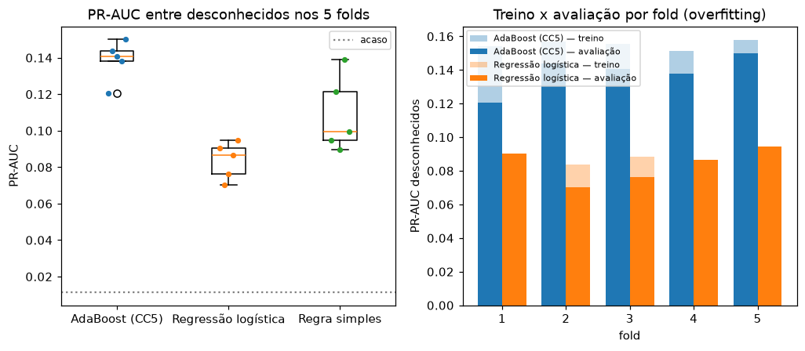
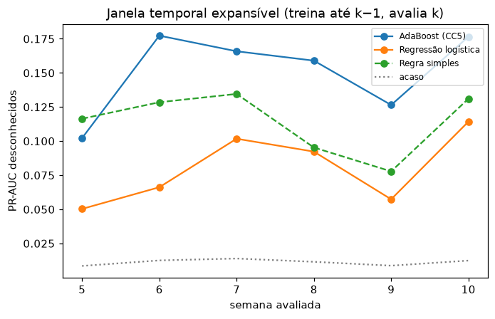

# Validação cruzada e estabilidade — OpiniOn (CC6)

Gerado por `python -m opinion.modelo.validacao_cruzada` em 27/11/2026 20:03. Registrado no MLflow, experimento `opinion-cc6-validacao-cruzada`.

> Encontros e label simulados ([`fontes_dados.md`](fontes_dados.md)). As conclusões valem para o processo da simulação.

## 1. Protocolo

- **Dados:** treino + validação (semanas 1–10), 56.345 encontros de 40.491 pares. O teste (semanas 11–12) não entra.
- **Stratified k-fold agrupado por par** (`StratifiedGroupKFold`, k = 5): todos os encontros de um par ficam no mesmo fold, o que impede que o modelo seja avaliado em um par que ele já viu no treino. A estratificação mantém a taxa de conexão parecida entre os folds.
- **Estabilidade:** média, desvio-padrão, coeficiente de variação (CV) e amplitude da PR-AUC entre desconhecidos nos folds.
- **Overfitting/underfitting:** desempenho no próprio treino de cada fold contra o fold de avaliação, mais uma curva de aprendizado (frações de 10% a 100% do treino, subamostradas por par).
- **Generalização para o futuro:** janela temporal expansível, treinando nas semanas 1..k−1 (com purga dos encontros cujo label de 48 h invade a semana k) e avaliando na semana k.
- **Modelos:** AdaBoost com os hiperparâmetros do CC5 (`n_estimators=292, learning_rate=0.9384, max_depth=1`, origem: opinion-cc5-otimizado@otimizado (v1)), regressão logística (C = 1) como referência explicável e a regra simples (`compat_score`).

## 2. Resultados por fold (PR-AUC entre desconhecidos)

| Fold | AdaBoost otimizado (CC5) | Regressão logística (referência) | Regra simples | Prevalência |
|---|---|---|---|---|
| 1 | 0,121 | 0,090 | 0,095 | 0,011 |
| 2 | 0,144 | 0,070 | 0,122 | 0,012 |
| 3 | 0,141 | 0,076 | 0,090 | 0,011 |
| 4 | 0,138 | 0,086 | 0,139 | 0,012 |
| 5 | 0,150 | 0,095 | 0,100 | 0,011 |

## 3. Estabilidade

| Modelo | Média | Desvio | CV | Mín.–máx. | ROC-AUC desc. | Precisão no top 2% | Brier (sem calibrar) |
|---|---|---|---|---|---|---|---|
| AdaBoost otimizado (CC5) | 0,139 | 0,011 | 8,0% | 0,121–0,150 | 0,943 ± 0,010 | 15,2% | 0,1022 |
| Regressão logística (referência) | 0,084 | 0,010 | 12,0% | 0,070–0,095 | 0,895 ± 0,019 | 8,8% | 0,0624 |
| Regra simples | 0,109 | 0,021 | 19,0% | 0,090–0,139 | 0,935 ± 0,015 | 10,7% | não se aplica |

## 4. Overfitting e underfitting

| Modelo | PR-AUC no treino | PR-AUC na avaliação | Diferença | Diferença relativa |
|---|---|---|---|---|
| AdaBoost otimizado (CC5) | 0,155 | 0,139 | +0,016 | 11,8% |
| Regressão logística (referência) | 0,084 | 0,084 | +0,000 | 0,5% |

**Curva de aprendizado** (média de 3 folds):

| Fração do treino | Encontros | PR-AUC treino | PR-AUC avaliação |
|---|---|---|---|
| 10,0% | 4.502 | 0,265 | 0,113 |
| 25,0% | 11.265 | 0,220 | 0,120 |
| 50,0% | 22.556 | 0,157 | 0,132 |
| 75,0% | 33.779 | 0,157 | 0,135 |
| 100,0% | 45.076 | 0,155 | 0,135 |

## 5. Generalização para semanas futuras

| Semana avaliada | Encontros de treino | AdaBoost otimizado (CC5) | Regressão logística (referência) | Regra simples | Prevalência |
|---|---|---|---|---|---|
| 5 | 23.028 | 0,102 | 0,050 | 0,116 | 0,008 |
| 6 | 28.328 | 0,177 | 0,066 | 0,128 | 0,013 |
| 7 | 33.202 | 0,166 | 0,102 | 0,135 | 0,014 |
| 8 | 38.399 | 0,159 | 0,092 | 0,095 | 0,012 |
| 9 | 46.244 | 0,126 | 0,057 | 0,078 | 0,009 |
| 10 | 50.247 | 0,177 | 0,114 | 0,131 | 0,012 |

As semanas 3 e 7 têm convenção de games, e a semana 11 (no teste) também. A variação entre semanas inclui essa mudança de contexto.

## 6. Análise

- **Estabilidade:** AdaBoost teve PR-AUC entre desconhecidos de 0,139 ± 0,011 (CV 8,0%, de 0,121 a 0,150). A variação entre folds é baixa: o resultado não depende de uma partição favorável.
- **Contra as referências:** o modelo otimizado superou a regra simples em 4 de 5 folds (média 0,139 x 0,109) e a regressão logística na média (0,139 x 0,084).
- **Ajuste:** a diferença entre treino (0,155) e avaliação (0,139) é de 11,8%. Há algum sobreajuste, esperado em modelos de conjunto, mas sem sinal de memorização forte. A curva de aprendizado se estabiliza no fim (+0,001 no último passo): mais encontros simulados do mesmo tipo trariam pouco ganho; o limite está na informação disponível.
- **Referência explicável:** a regressão logística tem diferença treino-avaliação de 0,5%, menor que a do modelo otimizado. Modelos mais simples generalizam de forma mais previsível, mas ficam abaixo na média.
- **Futuro:** treinando só com o passado, o modelo otimizado ficou entre 0,102 e 0,177 nas semanas avaliadas (média 0,151), contra 0,139 no k-fold. A diferença é pequena: o desempenho se mantém quando o modelo prevê semanas que não viu.
- **Teste:** a PR-AUC medida uma vez no teste do CC5 (0,188) fica fora da faixa dos folds; as semanas 11–12 incluem uma convenção de games, onde a taxa de conexão é maior, o que muda a prevalência e a métrica.

## 7. Limitações

- O k-fold mistura semanas: um fold pode treinar com encontros posteriores aos que avalia. As features continuam calculadas só com o passado de cada encontro, mas mudanças de comportamento ao longo do tempo ficam escondidas. Por isso a seção 5 complementa com a janela temporal.
- Os hiperparâmetros vieram do CC5, escolhidos na validação (semanas 9–10), que faz parte destes folds. A média da CV é, portanto, levemente otimista para o modelo otimizado.
- Com label simulado, estabilidade alta significa que o modelo aprende de forma consistente o processo da simulação; com pessoas reais (semana 16) a análise precisa ser refeita.
